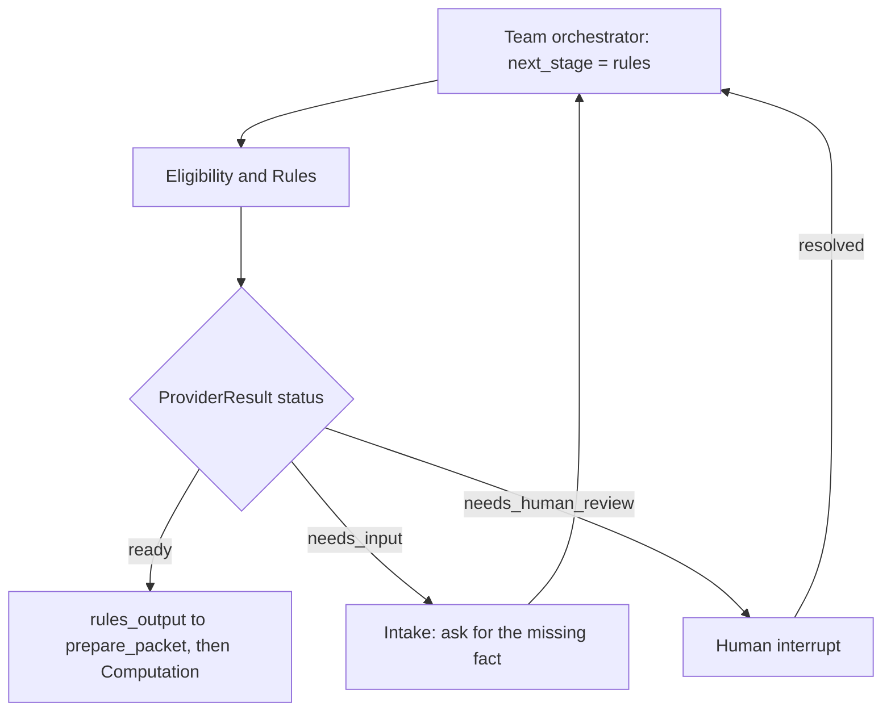

# SilverFile - Eligibility & Rules (jijuan/eligibility)

This branch implements the **Eligibility & Rules** component for Assignment 7. It cites a
reference corpus (`eligibility_rules.py`) for every decision, determines which rules apply to
a case, and either clears it for Computation or stops it with named blocking conditions. It
does not produce a complete tax return by itself. The other five agents, orchestration graph,
full dashboard, deterministic tax MCP tools, and final form generation belong to the team
integration.

## Setup and run

Use Python **3.11, 3.12 or 3.13**. Run commands from this repository's root.

This branch holds only the Eligibility & Rules component. Its tests import three modules that
live on `yong/integration` — `src/integration/adapters.py`,
`src/document_extraction/models.py` and `src/agents/computation_contract.py` — so merge onto
that branch to run them.

```bash
git clone https://github.com/DhruvRawat418/Assignment7_taxsystem.git
cd Assignment7_taxsystem
git checkout yong/integration
git merge origin/jijuan/eligibility --no-edit

python3.11 -m venv .venv
source .venv/bin/activate
python -m pip install -r requirements-eligibility.txt

# 52 tests: decision table, boundary dates, box dispositions, citation integrity,
# and a round trip through the real integration adapter.
python -m pytest tests/eligibility -q

# Clean run: single filer aged 65+, one W-2, cleared for Computation.
python -m demo.run_eligibility --scenario clean

# Escalation run: rental income and a request for advice, each with its authority.
python -m demo.run_eligibility --scenario out-of-scope --rules
```

On Windows, create the environment with `py -3.11 -m venv .venv` and activate it with
`.venv\Scripts\activate`. If `pytest` resolves to an Anaconda install instead of the virtual
environment, call `.venv\Scripts\python.exe -m pytest`.

Scenarios available: `clean`, `ineligible`, `out-of-scope`, `bereaved`, `needs-intake`.
`--rules` prints the text and source of every rule cited by that run.

No API key, LLM SDK or hosted model is required. `requirements-eligibility.txt` pins
`pydantic`, plus `numpy` and `Pillow` — the latter two are unused here and are pulled in
transitively because `src/document_extraction/__init__.py` eagerly imports the OCR module.

## What this component decides

| Decision | Rule ids |
| --- | --- |
| 1040-SR eligibility — born before 2 Jan 1961, one spouse suffices on a joint return | `SR-ELIG-01..03` |
| Filing status validity across all five statuses | `FS-01..04` |
| Line 12d box answers and the per-box increment tier | `SD-02`, `SD-03` |
| Standard Deduction Chart availability and its three disqualifiers | `SD-01`, `SD-04`, `SD-05` |
| Enhanced senior deduction: qualifying persons, Schedule 1-A, line 13b, phase-out basis | `ESD-01..04` |
| Which schedules apply | `SCHED-01`, `ESD-04` |
| In-scope vs out-of-scope determination | `SCOPE-01..08` |
| A disposition for every extracted document box | `W2-BOX-01..06` |

`eligibility(state)` reads `intake_snapshot["facts"]`, `documents` and `extractions`, and
returns a `ProviderResult`. It never mutates state and never chooses the next node.

| Status | Meaning | Supervisor action |
| --- | --- | --- |
| `ready` | `data` is the `rules_output` packet: `profile`, `clearance`, `box_dispositions` | Pass to `prepare_packet`, then Computation; this is not a tax approval |
| `needs_input` | A fact this component cannot supply | Return the case to Intake; this component never opens a side dialogue |
| `needs_human_review` | Blocking conditions, each carrying its authority | Interrupt to a human |
| `failed` | State or constructed packet did not validate | Block; this is a defect, not a taxpayer problem |

## Citations are verifiable

Rule evaluation is deterministic Python, not a prompt. A citation only means something if it
can be checked, so every citation is produced by `cite()`, which raises `UnknownRuleError` on
any id absent from the corpus. A determination carrying an invented authority **cannot be
constructed**, which moves the failure from "silently wrong on a tax form" to "loudly wrong in
the test suite".

A language model is used in one place only, `scope_sentinel`, which classifies free-text
intake notes against the out-of-scope rules. Its output is constrained to corpus ids, every
returned id is re-validated, and anything unverifiable or low-confidence escalates instead of
deciding. With no model configured the component still runs and free text escalates.

`explain(rule_id)` returns a rule's title, text and source, so a cited id can be rendered as
something a Kushim employee can read.

## No dollar amounts

This component emits the *parameters* a rule needs — box count, increment tier, chart row,
qualifying person count — and never the money. Computation derives every amount through a
deterministic MCP tool call, so each number has one provenance path.
`test_no_dollar_amount_is_emitted` asserts that no determination value is one of the 2025
statutory figures.

Box dispositions follow the same discipline. Boxes 1 and 2 map to lines 1z and 25a; every
other recognised box is `not_used` with a written reason and a citation, so an excluded box is
never silently dropped and never assumed zero. A box the corpus does not classify blocks the
case with `unrecognized_document_box` — a box nobody has classified might be taxable, and
guessing is the failure that matters here.

## Escalation

All six §4.4 conditions are covered. Blockers are collected in a single pass, so a taxpayer
with three problems reaches a human once with three findings rather than over three rounds.

| Condition | Issue code | Authority |
| --- | --- | --- |
| Out-of-scope item from §3.3 | `*_out_of_scope` (eight codes) | `SCOPE-02..07`, `SD-05` |
| User statement conflicts with a document | `document_requires_attention`, `extraction_missing` | `HITL-01`, `SCOPE-01` |
| 1099-R with box 2b checked | corpus rule in place; disposition pending 1099-R extraction | `SCOPE-08` |
| Request for tax advice or planning | `tax_advice_requested` | `ADVICE-01` |
| Filing-status ambiguity | `filing_status_ambiguous` | `FS-02` |
| Financial exploitation or third-party pressure | `possible_exploitation` | `HITL-02` |

Filing-status ambiguity short-circuits before the status is validated: where a spouse died
during the tax year, MFJ, QSS and Single may each be correct, and the ambiguity *is* the
answer. Exploitation signals are noticed and stopped, never adjudicated.

Two further refusals are deliberate. Spouse age or blindness on a **separate** return raises
`separate_return_spouse_boxes` rather than being counted either way; Computation's `Profile`
carries `mfs_spouse_allowance_approved` precisely so this component can decline to approve it.
Unclassifiable free text raises `unclassified_free_text`. Both make "I'm not sure — flag this
for a volunteer" a reachable, correct outcome.

This component never asks for or stores an SSN. `SSN-01` is in the corpus for citation; the
900-series guardrail is enforced centrally so there is no second source of truth.

## Eligibility flow and team integration



This diagram covers the Eligibility & Rules stage only. The supervisor graph, parallel
extraction branch and its reducer, bounded review/revise cycle, no-progress handoff guard,
dashboard and form generation remain team integration work.

Registering the component is one line in the orchestrator —
`Providers(rules=make_eligibility_node(), ...)`. Nothing else is needed: `CaseState.rules_output`
exists and `findings_route` already maps `route_to="eligibility_rules"` back to this stage.
That change belongs to the orchestrator owner and is deliberately not made here.

Intake is the open dependency. The required-facts table in
[docs/ELIGIBILITY.md](docs/ELIGIBILITY.md) is the specification to build against; without
those keys every case returns `needs_input`.

## Known limits

Only W-2 box dispositions are implemented, because `W2Record` is the only document type
currently available from extraction. SSA-1099, 1099-R, 1099-INT and 1099-DIV rules are in the
corpus and the 1099-R box 2b escalation is specified, but the disposition tables need
extending once those forms are supported. Until then a non-W-2 document escalates, which is
the safe failure.

The corpus `source` strings reference the assignment brief. If a different reference corpus is
supplied, replace those strings and keep the ids; the component depends only on ids.

See [integration contract and design notes](docs/ELIGIBILITY.md) and
[AI-use disclosure](docs/AI_DISCLOSURE_ELIGIBILITY.md).
