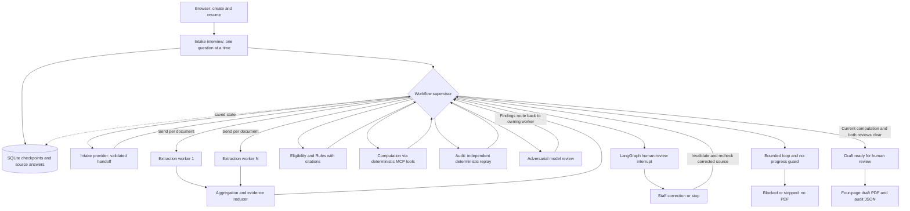

# SilverFile — 2025 Form 1040-SR draft preparation

SilverFile collects a saved interview, reads synthetic W-2 images, runs the
LangGraph agent workflow and produces a draft tax form plus reviewable audit
record. Staff resolve supported input mistakes in the dashboard. Nothing is
filed, no tax advice is given, and uncollected identity/signature details are
not invented.

## Start the dashboard

With Docker Desktop running:

```sh
git clone --branch main https://github.com/DhruvRawat418/Assignment7_taxsystem.git
cd Assignment7_taxsystem
docker compose up -d --build --wait --wait-timeout 90
```

Open **http://localhost:8501**. Configure your own OpenAI key in **Model settings**
before invoking the live AI reviewer; never commit a key. Use synthetic classroom
data only. Case databases and uploads persist in the Docker volume.

- [Docker setup and complete grader guide](README_Docker.md)
- [Detailed Docker troubleshooting](docs/DOCKER_QUICKSTART.md)
- [Local Python setup](README_TEAM.md)
- [Clean GUI scenario](demo/eval_case_1.md) and [resolved human-review scenario](demo/eval_case_2.md)
- [Staff W-2 upload, replacement and tax-form correction](docs/DOCUMENT_EDITOR.md)
- [Guardrails, coverage limits and checks](docs/GUARDRAILS.md)
- [Final integration verification](docs/FINAL_INTEGRATION_2026-10-30.md)
- [Memory experiment](docs/metrics.md)
- [AI-use attribution](docs/AI_DISCLOSURE.md)
- [Submission checklist and remaining report/video tasks](docs/SUBMISSION_CHECKLIST.md)

## Architecture



The diagram shows allowed routes, not simultaneous execution of every stage.
Only document extraction is the genuine parallel branch. The review/revise
cycle rechecks evidence; a human action cannot simply mark stale calculations
approved. Inspect [the graph implementation](src/integration/graph.py) and tests
for routing, reducer behavior and explicit iteration/no-progress bounds.

## Contributions and submission status

Original contributor histories are retained: Hanna — Intake/memory; Xinrui —
extraction/task division; Jijuan — Rules/guardrails; Xiaolong — computation/Docker;
Yong — Audit/security/dashboard, document editor and dependent-withdrawal fix;
Dhruv — orchestration/application integration, PDF export and release verification.
The team must confirm the named specialization table in its report.

The application code is integrated. Final report, role table, video and a teammate's
fresh-machine verification remain tracked in the submission checklist. This is a
local single-operator classroom application, not a production or filing service.
