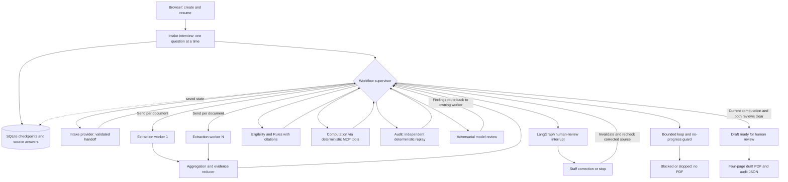

# SilverFile — 2025 Form 1040-SR draft preparation

SilverFile conducts a saved intake interview, reads synthetic W-2 images, runs a
LangGraph agent workflow, pauses for staff review when needed, and produces a
four-page draft 1040-SR plus an audit record. **Nothing is filed with the IRS.**

## Run with Docker

Install and open Docker Desktop first. GitHub repository access and internet are
required for the initial build. From a terminal:

```sh
git clone --branch main https://github.com/DhruvRawat418/Assignment7_taxsystem.git
cd Assignment7_taxsystem
docker compose up -d --build --wait --wait-timeout 90
```

Open **http://localhost:8501**. In **Model settings**, enter an OpenAI key with
credits and access to `gpt-4.1-mini`. The key is not included in the repository or
image. Create a fresh case and follow one of the evaluation guides below. Python,
VS Code and LangGraph Studio are not needed for Docker operation.

- [Detailed Docker instructions, troubleshooting and persistence](docs/DOCKER_QUICKSTART.md)
- [Local Python installation](README_TEAM.md) — install `requirements-team.txt`;
  the historical root `requirements.txt` is extraction-only.
- [Browser workflow](docs/BROWSER_WORKFLOW.md)

Only synthetic data is supported; practice SSNs must start with 900–999. The
classroom dashboard is local and single-operator, with no staff login. Docker
stores case databases and uploads in a persistent volume. Stop with
`docker compose down`; restart with `docker compose up -d`. Do not add `-v`
unless you intend to delete saved cases.

## Grader walkthrough

| Demonstration | Instructions | Expected outcome |
| --- | --- | --- |
| Clean case / W-2 OCR | [eval_case_1](demo/eval_case_1.md) | Reviewed draft PDF and audit JSON |
| Human-in-the-loop case | [eval_case_2](demo/eval_case_2.md) | Pause, attributed correction, fresh checks, revision 2 and PDF |
| Dependent transcription | [dependent check](docs/DEPENDENT_SCOPE_VERIFICATION.md) | Names, synthetic SSNs and relationships on the PDF |
| Memory experiment | [metrics and raw API usage](docs/metrics.md) | Ten distinct synthetic W-2 variants, two context strategies |

Use **Use sample W-2** when offered, or upload `demo/w2_clean.jpg`. The second
case deliberately enters an incorrect itemizing answer so the grader can resolve
it; do not change a truthful out-of-scope answer to bypass review. Ready means a
draft is available for human review, not that a return has been filed or approved.

### Staff document corrections

At the top of **Case workspace**, choose **Open a case** and use
**Upload / replace W-2** or **Correct tax form types**. The same controls appear
in an active interview. Select the actual forms, attach synthetic images or the
bundled sample, enter staff name/reason and confirm, then **Save document changes**.
Complete any additional questions and explicitly **Run checks & AI review**.
Earlier answers and image history are retained; previous reviews and PDF controls
are revoked until fresh checks pass. Saving itself makes no model call.
See [document editor](docs/DOCUMENT_EDITOR.md).

### Guardrails and ethics checks

Jijuan's component is integrated under `src/guardrails/` with conformance tests
and a fixed red-team corpus. Run it without a model or network:

```sh
docker compose run --rm --no-deps app python -m demo.run_guardrails --json
```

The report distinguishes passing probes from partial overall coverage. Fourteen
cases inject already-derived Intake flags; these do not prove recognition of the
original phrasing. See [guardrails](docs/GUARDRAILS.md) and
[conformance harness](docs/GUARDRAILS_CONFORMANCE.md).

## Tests and evidence

```sh
docker compose run --rm --no-deps app python -m pip check
docker compose run --rm --no-deps app python -m pytest tests -q -p no:cacheprovider
```

On October 29, the integrated runtime including the dependent-withdrawal fix
passed **405 tests and 37 subtests** in Docker. Twelve opt-in integration tests
passed in a separate run. Tests use labelled external-review doubles; real clean,
human-correction and dependent exports were checked separately. The live token
experiment used 20 requests and measured an 81.61% reduction in total input tokens
for selective recall. This is not an accuracy or dollar-cost claim.

See [verification history](docs/RELEASE_VERIFICATION.md),
[AI-use disclosure](docs/AI_DISCLOSURE.md) and
[submission checklist](docs/SUBMISSION_CHECKLIST.md).

## Repository and deliverables

| Location | Purpose |
| --- | --- |
| `src/agents/` | Intake, Rules, Computation, Audit and model-review contracts/implementations |
| `src/document_extraction/` | Real image OCR and typed document evidence |
| `src/integration/` | Supervisor graph, shared state, persistence and human review |
| `src/tools/` | Deterministic MCP calculation tools |
| `dashboard.py`, `pdf_export.py`, `assets/` | Staff dashboard and verified PDF template/export |
| `data/`, `demo/` | Synthetic fixture generators, images and two grader scenarios |
| `evals/cases.json` | Machine-readable index of the documented manual evaluation cases |
| `tests/` | Component, orchestration, browser and PDF regressions |
| `docs/` | Design, metrics, disclosures, Docker guide and verification records |
| `Dockerfile`, `compose.yaml`, `requirements-docker.txt` | Reproducible container environment |
| `.env.example` | Variable names only; no credentials |

Runtime traces and provenance are available through the dashboard and downloaded
audit JSON; personal case databases and uploads are not committed. The sample
repository layout in the assignment is illustrative: our graph/state live under
`src/integration/`. The integrated entry point is the dashboard; `run.py` remains
a historical component/skeleton diagnostic.

## Architecture



The diagram shows allowed routes, not simultaneous execution of every stage.
Only document extraction is the genuine parallel branch. The review/revise
cycle rechecks evidence; a human action cannot simply mark stale calculations
approved. Inspect [the graph implementation](src/integration/graph.py) and tests
for routing, reducer behavior and explicit iteration/no-progress bounds.


## Contributions and remaining submission work

Integrated contributions: Hanna — Intake/memory; Xinrui — extraction/task division;
Jijuan — Rules/guardrails; Xiaolong — computation/Docker; Yong — Audit/dashboard,
document correction and dependent withdrawal fix; Dhruv — orchestration/application integration, PDF export and
release verification. Original contributor commit histories are preserved.
The team must confirm its final named specialization table in the report.

**Pending:** a teammate's fresh-machine check, the final five-page report, the
confirmed role table, and the 5–10 minute demo video/link. These can be added in
follow-up pull requests. This is the runnable application baseline, not a claim
that the entire assignment submission is complete.

Known limits: uncollected taxpayer/spouse identity/address fields remain blank;
dependent credit amounts are sourced direct inputs, not automatically inferred;
more than four dependents require staff handling. Supporting schedule PDFs and
uncollected elections/signatures are not generated. See the checklist and component
notes for further scope limits. [Historical component notes](docs/COMPONENT_HISTORY.md)
are retained separately so they do not obscure the current setup instructions.
