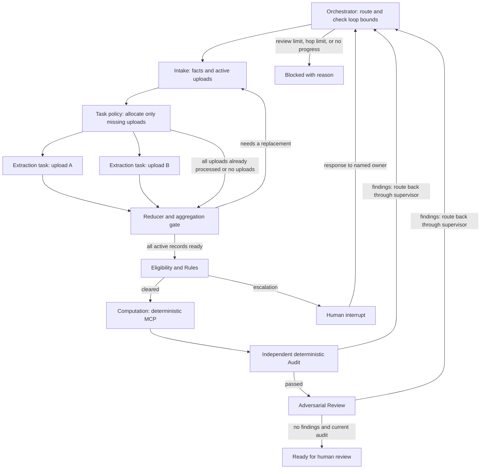
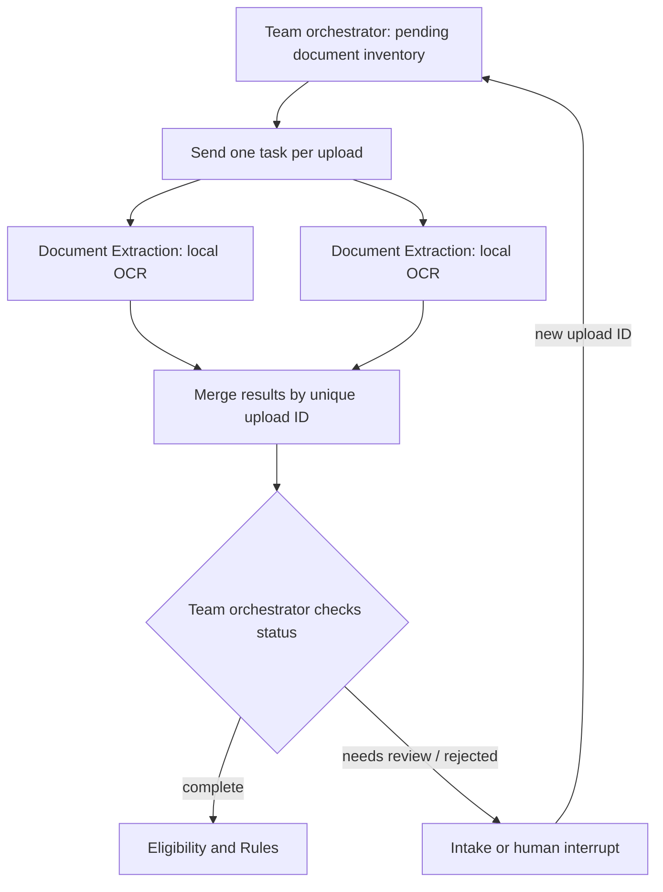

# SilverFile — Xinrui/work

Xinrui's contributions are **Document Extraction** and **Task Division &
Management**. This branch merges Yong's integration history so the allocation
policy runs inside the actual shared supervisor. Computation, Audit, and the
original supervisor remain attributed to their authors in Git history.
Main and the contributors' source branches are unchanged.

```bash
git clone --branch Xinrui/work https://github.com/DhruvRawat418/Assignment7_taxsystem.git
cd Assignment7_taxsystem
python3.11 -m venv .venv
source .venv/bin/activate
python -m pip install -r requirements-lock.txt -r requirements-integration.txt
python run.py --readiness
python run.py                         # intentionally blocked; exit code 2
python run.py --synthetic-demo --task-plan
python run.py --synthetic-hitl-demo --task-plan
python -m pytest -q
```

The two demos use actual MCP Computation and Audit; Intake, Rules, Extraction,
and Adversarial Review are explicitly labelled test providers. The second demo
resumes a real LangGraph interrupt using a synthetic test-driver response.
Both expose the current task/dependency board through `--task-plan`.



The allocation policy is in [task_division.py](src/integration/task_division.py).
It shares one plan between fan-out and aggregation, reuses successful uploads,
and assigns failed uploads to Intake. Only the active inventory affects readiness;
superseded evidence stays in history. The supervisor retains final routing,
review bounds, no-progress detection, and human-response checks.

**Current boundary:** the Task Division component is implemented and tested.
Direct real-provider integration stops at the Rules metadata contract mismatch;
the adversarial provider and finished UI/form are still needed. A successful demo
means `ready_for_human_review`, not a rendered or filed return.

See [Task Division implementation, verification and exact blockers](docs/TASK_DIVISION.md),
[integration contracts](docs/INTEGRATION.md), and
[Xinrui's AI-use disclosure](docs/AI_DISCLOSURE.md).
On 2026-10-27 this macOS 26.3.1 host passed the full suite including real OCR.
The macOS 13 ONNX issue in Yong's integration guide is that host's historical
result, not the outcome of this branch's latest verification.

## Imported Yong Cai Review / Audit component (`yong/audit`)

Yong's original component provides the deterministic Audit checks for SilverFile.
It is not the complete multi-agent application, a tax adviser, an LLM adversarial
reviewer, or permission to file a return. Other agents remain on their owners'
branches. The independent integration branch also imports Extraction and
Computation histories without changing their source branches.

Python 3.11+; no dependencies or API keys required for the standalone tests:

```bash
python -m unittest discover -s tests -v
python -m demo.run_audit --synthetic-demo
python -m demo.run_audit --synthetic-demo --tamper
```

The first demo uses an explicitly labelled **test-only tool double, not MCP**.
It exits 0 for the synthetic clean packet. The tampered demo exits 1 with
`revision_required`. Do not use that double to validate real returns.

```bash
python -m demo.run_audit path/to/audit_packet.json
```

The packet command has no configured MCP client and intentionally cannot pass.
Integrate a real client using `make_audit_node(client)` as described in
[docs/AUDIT.md](docs/AUDIT.md). That document defines input/output fields, source
bindings, fail-closed status routing, and the remaining integration work.

AI assistance is disclosed in [docs/AI_DISCLOSURE_AUDIT.md](docs/AI_DISCLOSURE_AUDIT.md).
## Document Extraction component (original Xinrui/work guide)

This branch implements **Document Extraction** component for Assignment 7.
It reads synthetic W-2 images locally and returns typed records with evidence for
each monetary value. It does not produce a complete tax return by itself. The other
five agents, full dashboard, deterministic tax MCP tools, and final form generation
belong to the team integration.

## Setup and run

Use Python **3.11 or 3.12**. Run commands from this repository's root.

```bash
git clone --branch Xinrui/work https://github.com/DhruvRawat418/Assignment7_taxsystem.git
cd Assignment7_taxsystem
python3.11 -m venv .venv
source .venv/bin/activate
python -m pip install -r requirements-lock.txt -r requirements-integration.txt

# Real OCR of a JPEG image, no API key or hosted model required.
python extract_documents.py demo/w2_clean.jpg --output outputs/clean.json

# Unit, real-image OCR, reducer, parallelism, and interrupt/resume tests.
python -m pytest -q

# Working LangGraph fan-out / aggregation example.
python -m examples.parallel_extraction

# Working extraction-only HITL pause and resume example.
python -m examples.hitl_extraction
```

On Windows, create the environment with `py -3.11 -m venv .venv` and activate it with
`.venv\Scripts\activate`. The lock file pins the tested environment including
LangGraph and pytest. `requirements.txt` contains only the standalone extractor's
direct dependencies; `requirements-dev.txt` adds the integration/test tools.
Installation needs internet access; inference uses packaged local OCR models.

For another synthetic image:

```bash
python extract_documents.py path/to/w2.png --output outputs/extraction.json
```

The CLI returns exit code **0** when all documents are extracted and **2** when any
document is rejected or needs review. Exit code 2 is expected for:

```bash
python extract_documents.py demo/w2_missing_withholding.jpg --output outputs/review.json
```

## What is extracted

PNG, JPEG, or WEBP; one upright W-2 copy per image, at most 20 MiB / 20 million
pixels. EXIF orientation is applied. Printed year, synthetic employee SSN, employer
EIN, and monetary boxes **1-8, 10, 11** are supported. Boxes **1 and 2** and the
printed year are required for a complete extraction. A readable SSN/EIN is retained
when present; a masked or absent identifier does not require extra PII. Optional
blank boxes are absent, not zero; unreadable nonblank content requires review.
Box 9 is unused. Codes, checkboxes, and boxes 12-20 are not
transcribed by this component. The assignment's tested W-2 wages/withholding path
uses boxes 1 and 2. The team must decide separately whether additional document
fields are needed for its return profile.

`value` is a `Decimal` in Python and a decimal string in JSON. Each accepted amount
has a source document ID, SHA-256, page, printed box, raw OCR text, confidence,
image size, bounding box, agent name, engine version, and UTC timestamp. A later
agent decides where each printed box belongs on a return and performs all required
sums through deterministic MCP tools.

Three statuses are available:

| Status | Meaning | Supervisor action |
| --- | --- | --- |
| `extracted` | Required fields passed extraction checks | Pass facts to Rules/Review; this is not a tax approval |
| `needs_review` | Missing, ambiguous, unreadable, or unsupported document | Ask Intake for a clearer document; unresolved cases must interrupt |
| `rejected` | Unsafe SSN or invalid image | Block this upload and request a synthetic replacement |

Only SSNs starting **900-999** are accepted. A rejected SSN is not copied into
the output or an error message. Intake must also call the supplied validation
helper **before storing any user-entered SSN**. OCR cannot guarantee detection of
every identifier in an unreadable image, so use synthetic documents only.

Input validation lives at `extract_w2`: image checks run once, and each OCR token
is parsed as money once and reused. Internal code trusts those results. The one
exception handler converts expected image-input failures to `invalid_image`;
model initialization and inference errors propagate to the caller. Missing or
ambiguous document values still produce review issues. No automatic retry or
fallback model is added.

## Extraction flow and team integration



This second diagram covers extraction only. The shared supervisor now supplies
review/revise limits and a no-progress guard; real-provider integration, the
dashboard, and tax return rendering still require team work as listed above.

See [integration contract](docs/DOCUMENT_EXTRACTION.md),
[implementation notes](docs/IMPLEMENTATION_NOTES.md),
[validation results](docs/EXTRACTION_VALIDATION.md),
[second review and fixes](docs/REVIEW_2026-10-24.md),
[demo 1](demo/eval_case_1.md), [demo 2](demo/eval_case_2.md),
and [AI-use disclosure](docs/AI_DISCLOSURE.md).
## Computation Agent contribution

Standalone Computation Agent, deterministic MCP tools, typed integration contract,
synthetic fixtures, and tests are available on this branch.
See [docs/COMPUTATION.md](docs/COMPUTATION.md) for scope, input/output fields,
setup, and integration instructions.

```bash
python -m pip install -r requirements-computation.txt
python -m demo.run_computation demo/computation_clean.json
python -m pytest -c tests/computation/pytest.ini tests/computation -q
```

This contribution implements only Computation. The other agents, global graph,
dashboard, PDF export, and complete application remain team integration work.
