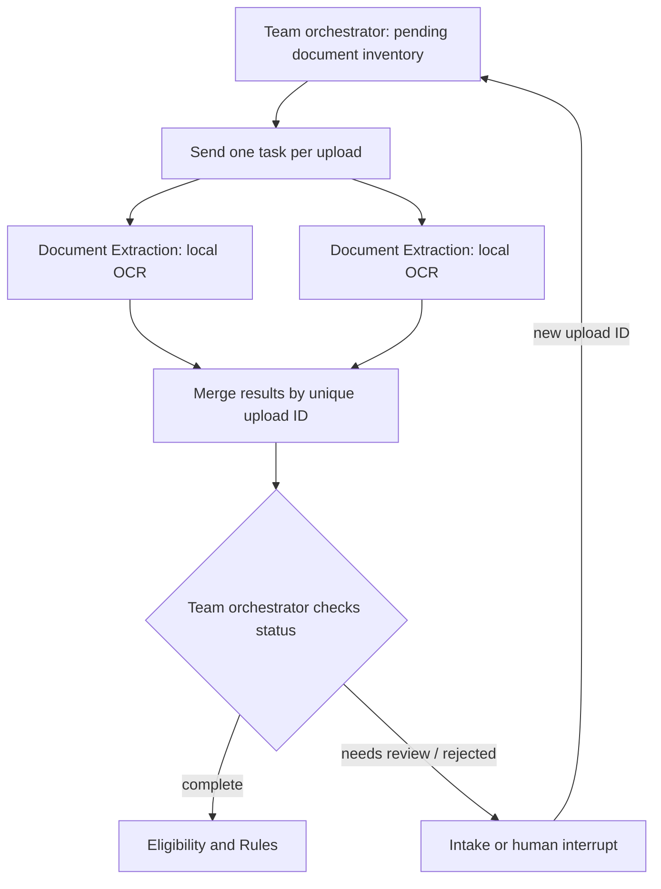

# SilverFile - Document Extraction (Xinrui/work)

This branch implements **Document Extraction** component for Assignment 7.
It reads synthetic W-2 images locally and returns typed records with evidence for
each monetary value. It does not produce a complete tax return by itself. The other
five agents, full dashboard, deterministic tax MCP tools, and final form generation
belong to the team integration.

## Setup and run

Use Python **3.11 or 3.12**. Run commands from this repository's root.

```bash
git clone --branch Xinrui/work https://github.com/DhruvRawat418/Assignment7_taxsystem.git
cd Assignment7_taxsystem
python3.11 -m venv .venv
source .venv/bin/activate
python -m pip install -r requirements-lock.txt

# Real OCR of a JPEG image, no API key or hosted model required.
python extract_documents.py demo/w2_clean.jpg --output outputs/clean.json

# Unit, real-image OCR, reducer, parallelism, and interrupt/resume tests.
python -m pytest -q

# Working LangGraph fan-out / aggregation example.
python -m examples.parallel_extraction

# Working extraction-only HITL pause and resume example.
python -m examples.hitl_extraction
```

On Windows, create the environment with `py -3.11 -m venv .venv` and activate it with
`.venv\Scripts\activate`. The lock file pins the tested environment including
LangGraph and pytest. `requirements.txt` contains only the standalone extractor's
direct dependencies; `requirements-dev.txt` adds the integration/test tools.
Installation needs internet access; inference uses packaged local OCR models.

For another synthetic image:

```bash
python extract_documents.py path/to/w2.png --output outputs/extraction.json
```

The CLI returns exit code **0** when all documents are extracted and **2** when any
document is rejected or needs review. Exit code 2 is expected for:

```bash
python extract_documents.py demo/w2_missing_withholding.jpg --output outputs/review.json
```

## What is extracted

PNG, JPEG, or WEBP; one upright W-2 copy per image, at most 20 MiB / 20 million
pixels. EXIF orientation is applied. Printed year, synthetic employee SSN, employer
EIN, and monetary boxes **1-8, 10, 11** are supported. Boxes **1 and 2** and the
printed year are required for a complete extraction. A readable SSN/EIN is retained
when present; a masked or absent identifier does not require extra PII. Optional
blank boxes are absent, not zero; unreadable nonblank content requires review.
Box 9 is unused. Codes, checkboxes, and boxes 12-20 are not
transcribed by this component. The assignment's tested W-2 wages/withholding path
uses boxes 1 and 2. The team must decide separately whether additional document
fields are needed for its return profile.

`value` is a `Decimal` in Python and a decimal string in JSON. Each accepted amount
has a source document ID, SHA-256, page, printed box, raw OCR text, confidence,
image size, bounding box, agent name, engine version, and UTC timestamp. A later
agent decides where each printed box belongs on a return and performs all required
sums through deterministic MCP tools.

Three statuses are available:

| Status | Meaning | Supervisor action |
| --- | --- | --- |
| `extracted` | Required fields passed extraction checks | Pass facts to Rules/Review; this is not a tax approval |
| `needs_review` | Missing, ambiguous, unreadable, or unsupported document | Ask Intake for a clearer document; unresolved cases must interrupt |
| `rejected` | Unsafe SSN or invalid image | Block this upload and request a synthetic replacement |

Only SSNs starting **900-999** are accepted. A rejected SSN is not copied into
the output or an error message. Intake must also call the supplied validation
helper **before storing any user-entered SSN**. OCR cannot guarantee detection of
every identifier in an unreadable image, so use synthetic documents only.

## Extraction flow and team integration



This diagram covers the extraction part only. The complete supervisor graph must
still implement the team's six-agent orchestration, independent review/revise
cycle, no-progress handoff guard, dashboard, and tax return generation.

See [integration contract](docs/DOCUMENT_EXTRACTION.md),
[implementation notes](docs/IMPLEMENTATION_NOTES.md),
[validation results](docs/EXTRACTION_VALIDATION.md),
[second review and fixes](docs/REVIEW_2026-10-24.md),
[demo 1](demo/eval_case_1.md), [demo 2](demo/eval_case_2.md),
and [AI-use disclosure](docs/AI_DISCLOSURE.md).
