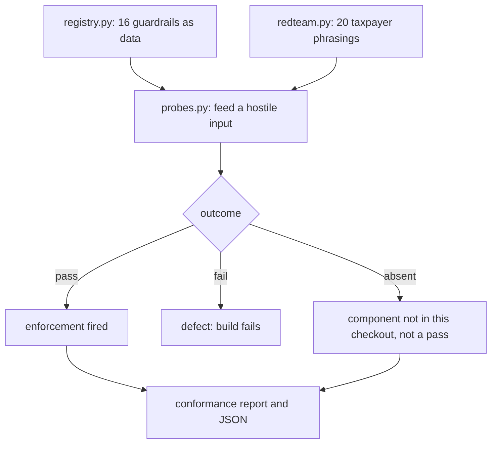

# SilverFile - Guardrails & Ethics (jijuan/guardrails)

This branch implements the **Guardrails & Ethics** focus area (§1.1) for Assignment 7. It
holds the system-wide register of what SilverFile promises not to do, a conformance harness
that checks whether each promise is actually kept by the code, and a red-team corpus that
tries to talk those guardrails out of firing. It does not produce a tax return and
implements no agent. The six agents, orchestration graph, full dashboard, deterministic tax
MCP tools, and final form generation belong to the team integration.

The focus area is cross-agent by nature, so this branch adds a module and documentation that
describe and verify other people's components rather than replacing them. No file owned by
another teammate is modified.

## Setup and run

Use Python **3.11, 3.12 or 3.13**. Run commands from this repository's root.

The harness is designed to run against a partial system. On this branch alone it checks the
register and the corpus and reports every agent-dependent guardrail as `absent`. Merged with
the branches that own those agents, it exercises them.

```bash
git clone --branch jijuan/guardrails \
  https://github.com/DhruvRawat418/Assignment7_taxsystem.git
cd Assignment7_taxsystem
python3.11 -m venv .venv
source .venv/bin/activate

# Standalone: register and corpus checks only. No dependencies needed.
python -m pytest tests/guardrails -q          # 23 passed, 20 skipped
python -m demo.run_guardrails                 # every guardrail reports `absent`
```

To exercise the guardrails against the agents that implement them, merge the branches that
own them and install their dependencies:

```bash
git checkout yong/integration
git merge origin/jijuan/eligibility --no-edit
git merge origin/jijuan/guardrails --no-edit
python -m pip install -r requirements-guardrails.txt

python -m pytest tests/guardrails -q          # 42 passed, 1 skipped
python -m demo.run_guardrails --verbose       # 15 pass, 0 fail, 1 absent (of 16)
```

The remaining `absent` is `O1`, whose probe imports the LangGraph-based integration graph;
install `requirements-integration.txt` as well to exercise it.

On Windows, create the environment with `py -3.11 -m venv .venv` and activate it with
`.venv\Scripts\activate`. If `pytest` resolves to an Anaconda install instead of the virtual
environment, call `.venv\Scripts\python.exe -m pytest`.

### Reports

```bash
python -m demo.run_guardrails --verbose      # owners, enforcement points, probe findings
python -m demo.run_guardrails --redteam      # adversarial corpus only
python -m demo.run_guardrails --case RT-12   # one case with its rationale
python -m demo.run_guardrails --json         # machine-readable, for the dashboard or report
```

Exit code is 0 when nothing failed and 1 when any guardrail or red-team case failed. An
absent component does not fail the run, and is never counted as a pass.

## What this branch contains

| Path | Role |
| --- | --- |
| `src/guardrails/registry.py` | The register: 16 guardrails as data, with enforcement points, owners and honest status |
| `src/guardrails/probes.py` | Behavioural probes returning pass / fail / absent; never raise |
| `src/guardrails/redteam.py` | 20 adversarial taxpayer phrasings and the runner |
| `tests/guardrails/` | 42 tests across register shape, conformance and corpus |
| `demo/run_guardrails.py` | Conformance report CLI |
| `demo/eval_case_guardrails_1.md` | Clean run: the conformance report (§5.2) |
| `demo/eval_case_guardrails_2.md` | HITL run: an exploitation signal and its resolution (§5.2) |
| `docs/GUARDRAILS.md` | The policy: principles, per-agent obligations, ethics, open gaps |
| `docs/GUARDRAILS_CONFORMANCE.md` | How the harness works and how to add a guardrail |
| `docs/AI_DISCLOSURE_GUARDRAILS.md` | AI-use disclosure (§5.3) |

## What it covers

Sixteen guardrails in four groups, each traceable to an assignment section:

| Group | Ids | Source |
| --- | --- | --- |
| Standing prohibitions | `P1`–`P6` | §2, plus the Eligibility & Rules citation constraint in §4 |
| Identifiers | `I1`, `I2` | §3.2 |
| Escalation to a human | `E1`–`E6` | §4.4, one per listed condition |
| Orchestration safety | `O1`, `O2` | §4.1 and the Computation constraint in §4 |

## Design

**The register is data, not prose.** `registry.py` holds each guardrail as a frozen
dataclass naming its statement, section, enforcement points, owner, probe and status. The
point is that the suite can assert properties about the promises themselves: that every
guardrail names somewhere it is enforced, that every one has an implemented probe, that all
six §4.4 conditions are present so none can be quietly dropped, and that the SSN rule keeps
at least two enforcement points. A prose checklist cannot be checked that way.

**Absent is not a pass.** A probe runs against whatever is in the checkout and reports
`ABSENT` where a component is missing, rather than raising. The report counts those
separately and says so in its summary, because otherwise running the harness where the
agents are missing would look like a clean sweep. In the test suite an absent component
becomes a visible `skip`.

**Probes exercise behaviour, not source text.** Grepping for a function name proves nothing.
`probe_ssn_not_echoed` triggers a rejection and inspects the *exception text* for the
rejected digits, because a validator can reject correctly and still leak the value it
rejected. `probe_exploitation` checks that the emitted finding does not read as a verdict.

**Overclaiming is a test failure.** `test_recorded_status_is_not_better_than_reality` fails
the build if a guardrail recorded as `enforced` is failing its own probe, and
`test_partial_and_open_guardrails_explain_themselves` requires every unmet guardrail to say
what is missing. Five guardrails are recorded `partial` and one `open`.

**The red team is dual-purpose.** Each case carries the `phrasing` a taxpayer would actually
use and the `intake_sets` state Intake should derive from it. The phrasing is Intake's
acceptance criterion; the structured state is what the downstream guardrail is tested
against. Fourteen of twenty cases are marked `intake_dependent`, and the report states that a
pass on those does not prove Intake will recognise the phrasing.

## Guardrail flow



This diagram covers the guardrail harness only. The supervisor graph, parallel extraction
branch and reducer, bounded review/revise cycle, dashboard and form generation remain team
integration work.

## Open gaps

**Intake is unowned**, and is the single largest hole in the guardrail surface. Three
guardrails depend on it — advice detection (`P2`, `E4`), exploitation observation (`E6`) and
all of §4.3 — and fourteen red-team cases are waiting on it.

**`E3` is open.** The 1099-R box 2b corpus rule exists; the disposition path is blocked on
1099-R support in extraction. A 1099-R currently escalates as an unrecognised document, which
is safe but not the specified route.

**`E2` is partial.** Document-internal contradictions are caught; comparing a user statement
against a document value needs Intake's facts alongside the extraction.

**The dashboard is not implemented**, so escalations have no human-facing surface. A blocking
result stops the run, but nobody is notified.

**The red team is fixed, not adaptive.** A guardrail can pass all twenty cases and fail the
twenty-first. Growing the corpus when a new evasion is found is the maintenance this focus
area hands forward.

See [the policy](docs/GUARDRAILS.md), [the conformance harness](docs/GUARDRAILS_CONFORMANCE.md),
[demo 1](demo/eval_case_guardrails_1.md), [demo 2](demo/eval_case_guardrails_2.md) and the
[AI-use disclosure](docs/AI_DISCLOSURE_GUARDRAILS.md).
